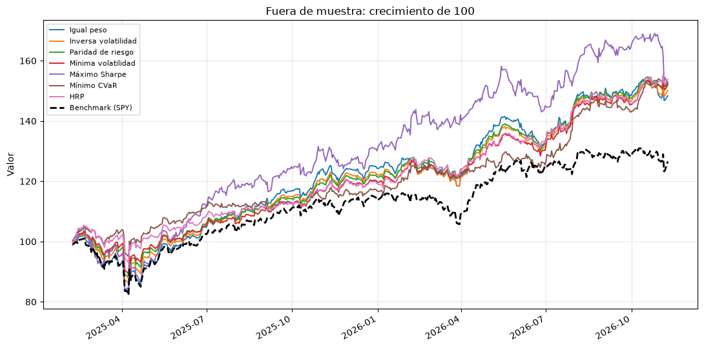
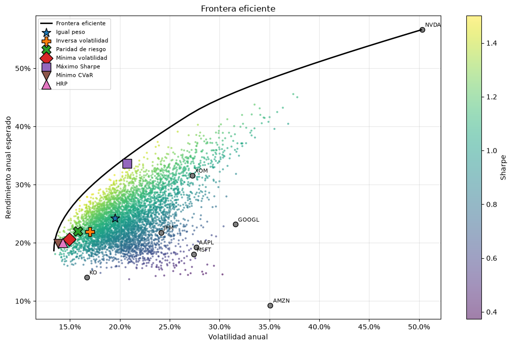

# Optimización de portafolios de acciones

Análisis cuantitativo y optimización de un portafolio con **cualquier cantidad de acciones**: métricas de riesgo,
diversificación, 7 estrategias de construcción y **validación fuera de muestra** para detectar sobreajuste.

| | |
|---|---|
| **App interactiva** (sin código, en el navegador) | [](https://mybinder.org/v2/gh/OmarRR2003/portfolio-optimization/main?urlpath=voila%2Frender%2Facciones.ipynb) |
| **Notebook con código** (solo lectura, carga rápida) | [](https://nbviewer.org/github/OmarRR2003/portfolio-optimization/blob/main/acciones.ipynb) |

> La app interactiva tarda 1–3 minutos en abrir la primera vez (Binder prepara el entorno y descarga los datos).



## Qué incluye

- **Panel para elegir acciones:** en la app, cualquier persona escribe sus propios tickers, fecha de inicio,
  benchmark y capital, pulsa *Analizar*, y todo el análisis se recalcula.
- **Datos:** precios ajustados de Yahoo Finance, limpieza automática (tickers inválidos, historiales cortos, huecos).
- **Métricas por activo:** CAGR, volatilidad, Sharpe, Sortino, máximo drawdown, Calmar, VaR/CVaR, asimetría, curtosis, beta, alfa, information ratio.
- **Diversificación:** matriz de correlación y pares más y menos correlacionados.
- **Estimación robusta:** covarianza con *shrinkage* de Ledoit-Wolf, límites de peso y regularización L2.
- **7 estrategias:** igual peso, inversa volatilidad, paridad de riesgo, mínima volatilidad, máximo Sharpe, mínimo CVaR y HRP (*Hierarchical Risk Parity*).
- **Validación fuera de muestra** con rebalanceo periódico frente al benchmark (SPY).
- **Tu portafolio actual:** escribe cuántas acciones tienes de cada empresa (`AAPL: 10, KO: 25`) y obtén
  su valor, diversificación real, contribución al riesgo, comparación con las estrategias y un plan de
  rebalanceo en acciones enteras (qué comprar y qué vender), con o sin dinero nuevo.
- **Simulación Monte Carlo de escenarios futuros:** 2,000 trayectorias por *block bootstrap* con un supuesto
  de rendimiento conservador (CAPM): escenarios pesimista/mediano/optimista en dinero, probabilidad de perder
  y caída esperada en el camino, para el horizonte y capital que elijas.
- **Portafolio final:** contribución al riesgo de cada acción y cuántas acciones comprar según tu capital.
- **Laboratorios interactivos** para ver cómo cambian los resultados al mover los parámetros.
- Las interpretaciones (*Tus resultados*) se generan a partir de los datos, así que se actualizan solas.



## Estructura

| Archivo | Rol |
|---|---|
| `libs.py` | Todas las librerías del proyecto |
| `acciones.py` | Lógica: datos, métricas, optimización, validación, gráficos e interpretación |
| `acciones.ipynb` | Notebook didáctico, visual e interactivo |

## Uso local

```bash
python -m venv .venv
source .venv/bin/activate
pip install -r requirements.txt

jupyter notebook acciones.ipynb                    # notebook
voila acciones.ipynb                               # como app web, sin código
python acciones.py AAPL MSFT KO XOM --capital 10000   # reporte en terminal + CSV y gráficos
python acciones.py MSFT --posiciones "AAPL: 10, KO: 25"  # incluye tu portafolio actual
python acciones.py --help                          # todas las opciones
```

## Librerias
Python · pandas · NumPy · SciPy · PyPortfolioOpt · yfinance · matplotlib · ipywidgets · Voilà

---

> Proyecto educativo. El desempeño pasado no garantiza resultados futuros; no es una recomendación de inversión.
